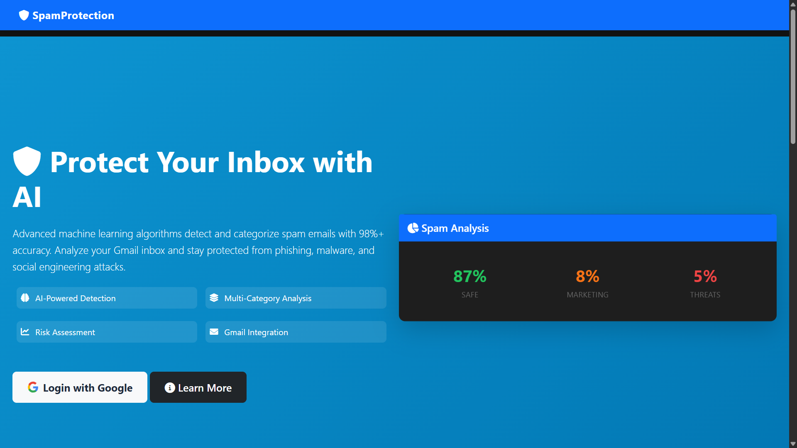
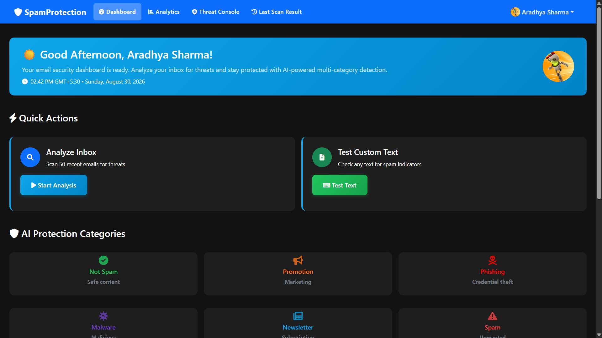
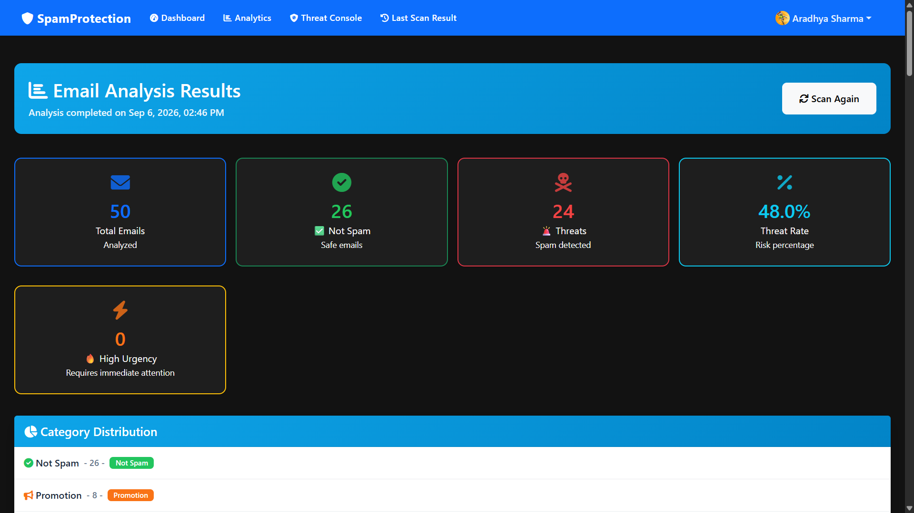
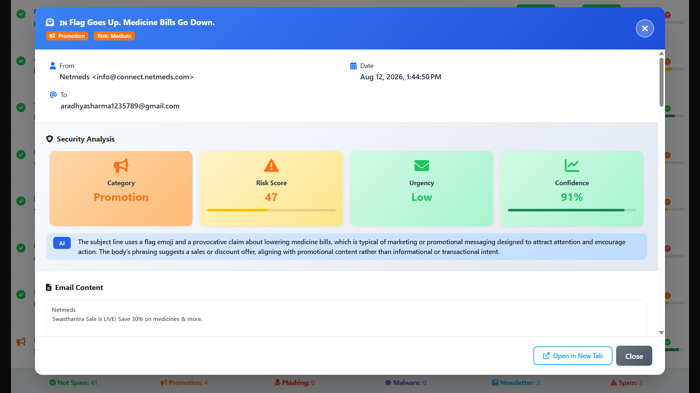

<div align="center">

# 🛡️ AI-Powered Email Spam Detection and Threat Analysis

[](https://github.com/abhisheksharma611/AI-Powered-Email-Spam-Detection-and-Threat-Analysis)


A local-first web app that reads your Gmail (read-only), classifies each
message into one of six categories with a fine-tuned RoBERTa + sklearn
ensemble, and explains every verdict with a risk breakdown, urgency score,
sender reputation, and an AI-written summary. Built as a 7th-semester major
project by **Abhishek Kumar T**. No hosting, no data leaves your machine.

</div>

## 📸 Screenshots

<div align="center">

<table>
<tr>
<td align="center"><br>🏠 Landing</td>
<td align="center"><br>📊 Dashboard</td>
</tr>
<tr>
<td align="center"><br>📋 Results</td>
<td align="center"><br>✉️ Email view</td>
</tr>
</table>

</div>

Screenshots live as PNGs under `docs/screenshots/`. App icons:
`static/img/logo.png` (37,653 bytes, navbar + login) and
`static/img/favicon.ico` (15,406 bytes, tab icon).

## Features

- **📅 Selectable scan period**, choose 7 days, 30 days, this month, or a custom
  date range before scanning. Your choice is remembered per account, so the next
  scan starts where you left off. Gmail's `before:` operator is exclusive, so
  custom ranges are sent as `before:<end>+1 day` to include the end date.
- **🧠 6-class classification**, legitimate, spam, promotion, phishing, malware,
  newsletter. Only spam, phishing, and malware count as threats.
- **Risk scoring (0-100)** with a visible breakdown: base model score plus
  urgency, learned-keyword, and sender-reputation boosts.
- **⏰ Urgency detection**, time-pressure language ("act now", "within 24 hours")
  scored separately from malice.
- **👤 Sender reputation**, per-sender history with time decay; repeat offenders
  raise the score of their future mail.
- **🌱 Adaptive keywords**, the app learns dangerous terms from high-confidence
  phishing/malware mail and boosts later mail containing them (capped, no
  runaway feedback).
- **📥 Gmail scan**, latest 50 mails, batched fetching with retry and backoff.
- **⚡ Sync + background scans**, small scans render directly; large ones run in
  a cancellable background task with a progress bar.
- **✏️ Single-text and bulk-paste analysis** without touching Gmail.
- **📈 Analytics + threat console**, category mix, urgency top-5, risk
  distribution, 7-day trend, high-risk timeline, plus fragment endpoints so the
  table and console refresh without a full page load.
- **🔍 Per-mail view**, sanitized body (XSS-stripped), 30-40 word explanation,
  full risk breakdown.

## 🏷️ Category & Risk Legend (as shown in the UI)

| Category | Badge | Meaning |
|---|---|---|
| ✅ Not Spam (`legitimate`) | green | Safe mail |
| 📢 Promotion | blue | Marketing, never counted as spam |
| 📰 Newsletter | grey | Subscriptions, never counted as spam |
| 🚨 Spam | red | Bulk junk |
| 🎣 Phishing | dark red | Credential-theft attempt |
| 🦠 Malware | purple | Malicious payload suspected |

Risk pills: 🟢 Low (0-40), ⚠️ Medium (41-60), 🔴 High (61-100).
Icons come from Font Awesome (CDN) plus the emoji above; charts from Chart.js.

## 🏗️ Architecture

```text
Browser (Jinja pages + vanilla JS + Chart.js)
  │  Flask routes (app.py, auth guard -> rate limit -> service call)
  ├── utils/auth.py          Google OAuth 2.0 (Authlib, offline + consent, nonce)
  ├── utils/gmail_client.py  Gmail API readonly (ID list -> batch get ×20 -> parse)
  ├── models/predictor.py    0.90 × RoBERTa + 0.10 × Ensemble per batch of 10
  ├── utils/helpers.py       urgency + sender reputation + learned keywords
  │                          + risk breakdown + 30-40 word summary
  ├── utils/ai_explanation.py  optional local Ollama summary (gemma2:2b, silent skip)
  └── models/email_model.py  SQLite via SQLAlchemy (Email, SenderReputation,
                             LearnedKeyword, OAuthStore, ScanSession)
```

One request path, one analysis pipeline, the sync route and the background
thread call the same `_process_single_email`, so both give identical verdicts.

## 🔄 How One Scan Works

```text
Login with Google -> Dashboard -> Scan inbox
  -> Gmail API fetches latest 50 (batches of 20, 429-aware retry)
  -> 0.90 × RoBERTa + 0.10 × Ensemble votes per message
  -> risk + urgency + sender reputation layered on top
  -> Results table -> open any mail for the full breakdown
```

## 🗺️ Pages & Routes

26 routes are declared in `app.py` (including the favicon). The main table,
plus four that are easy to miss:

| Route | What it does |
|---|---|
| `/` | 🏠 Landing page (redirects to dashboard when logged in) |
| `/login` | 🔑 Google sign-in page |
| `/auth/<provider>` | Starts the OAuth flow (currently only `google` is wired) |
| `/callback/<provider>` | OAuth callback, stores session, saves encrypted refresh token |
| `/logout` | 👋 Clears session, time-aware goodbye message |
| `/dashboard` | 📊 Greeting, clock, scan-period picker, last-scan banner, recent mail |
| `/analyze_emails` | 📥 Synchronous Gmail scan (rate-limited 10/min) |
| `/api/start_analysis` | ⚡ Starts a background scan, returns a task id (5/min) |
| `/api/analysis_status/<task_id>` | 📶 Progress polling for the frontend bar (120/min) |
| `/api/cancel_analysis/<task_id>` | 🛑 Cancels a running scan |
| `/results` | 📋 Filterable, sortable, paginated table (50/page) |
| `/results-fragment` | ♻️ Table-only partial, for refreshing rows without the full page |
| `/last-scan` | 🕘 The most recent 50 mails, same table |
| `/email/<email_id>` | 🔍 One mail: sanitized body + analysis + AI summary |
| `/analytics` | 📈 Urgency, risk distribution, 7-day trend |
| `/analytics-fragment` | ♻️ Analytics partial, refreshed by AJAX |
| `/admin/threat-console` | 🚨 High-risk timeline, category/urgency streams |
| `/threat-console` | 🚨 Operational threat console view (feeds + filters) |
| `/threat-console-fragment` | ♻️ Console partial, refreshed in place |
| `/api/analyze_text` | ✏️ Single-text classification (POST JSON, 10/min) |
| `/bulk_analyze` | 📚 Paste up to 100 texts, batch verdicts (5/min) |
| `/api/last_scan` | JSON summary of the latest scan (30/min) |
| `/api/status` | Model status, categories, endpoint map |
| `/health` | 💚 Liveness probe with model-loaded flag |
| `/set-timezone` | 🌍 Stores the browser timezone/locale in session |
| `/favicon.ico` | 🧿 Serve the tab icon |

## 🔌 API Reference

**`POST /api/analyze_text`** (login + JSON required)

```json
{ "text": "You have won a prize, claim within 24 hours" }
```

Returns `category`, `category_info`, `is_spam`, `risk_score`, `risk_level`,
`confidence`, per-class `probabilities`, `spam_probability`, `analysis_time`.
Limits: 5000 chars, 10 req/min. Missing models -> **503**, never a fake label.
Empty text -> 400, wrong content type -> 415.

**`POST /bulk_analyze`**, `{ "texts": ["...", "..."] }`, max 100 items,
5 req/min. Returns per-text verdicts plus a summary
(`total_analyzed`, `spam_detected`, `spam_percentage`, `threat_count`).

**`POST /api/start_analysis`** -> `{ "task_id": ... }`, then poll
`GET /api/analysis_status/<task_id>` (`progress`, `status`, `complete`,
`error`). Cancel with `POST /api/cancel_analysis/<task_id>`. Tasks are
per-user isolated and expire.

### ⏱️ Rate limits (in-process, single worker)

Implemented as a dict + `threading.Lock` keyed on IP, not a decorator-based
limiter library. Over-limit calls get JSON `429` with `Retry-After`.

| Endpoint | Limit |
|---|---|
| `/analyze_emails`, `/api/analyze_text` | 10/min |
| `/bulk_analyze`, `/api/start_analysis` | 5/min |
| `/email/<id>` | 20/min |
| `/api/last_scan` | 30/min |
| `/api/analysis_status` | 120/min |
| `/api/cancel_analysis` | none declared, the polling route carries the cap |

## 🧰 Prerequisites

- Python 3.11, `pip`, `git`, a Google account.
- ~2 GB free for the four model files, ~500 MB for pip packages.
- Windows PowerShell commands below; macOS/Linux equivalents differ only in
  venv activation (`source venv/bin/activate`) and `cp` vs `Copy-Item`.

## Setup — Step by Step

**1️⃣ Clone and enter the folder:**

```powershell
git clone https://github.com/abhisheksharma611/AI-Powered-Email-Spam-Detection-and-Threat-Analysis.git
cd "AI-Powered-Email-Spam-Detection-and-Threat-Analysis"
```

**2️⃣ Virtual environment + dependencies:**

```powershell
python -m venv venv; venv\Scripts\Activate.ps1
pip install -r requirements.txt
```

**3️⃣ Environment file** (everyone brings their own keys — see Gmail Keys):

```powershell
Copy-Item .env.example .env   # then edit .env and fill values
```

**4️⃣ Model weights** (code ships without them — download once):

```powershell
gh release download v1.0-models -D models/ --repo abhisheksharma611/AI-Powered-Email-Spam-Detection-and-Threat-Analysis
```

No `gh` CLI? Download the four files from the
[Releases page](../../releases/tag/v1.0-models) into `models/` manually.

**To retrain instead** (needs `KAGGLE_USERNAME` / `KAGGLE_KEY`, a CUDA GPU, and
several hours): rebuild the datasets with `models/roberta_train.py`, then run
`models/roberta_train.py` followed by `models/ensemble_train.py`. The exact
recipe is in [Training](#-training-exact-recipe) below.

**5️⃣ Database:**

```powershell
flask db upgrade
```

**6️⃣ Run** — pick one:

```powershell
python app.py                 # dev server, http://localhost:5000
gunicorn app:app --workers 1  # production-style, single worker only
python run_local.py           # guided setup + run (installs deps, checks .env)
```

Then: login with Google → Dashboard → Scan inbox (10 mails to start) →
Results → open a mail → Analytics.

## 🔑 Gmail Keys (Everyone Brings Their Own)

1. Google Cloud -> new project -> enable the **Gmail API**.
2. OAuth consent screen (External, Test mode is enough for a demo).
3. OAuth Client ID (Web app) -> redirect URI
   `http://localhost:5000/callback/google`.
4. Paste the ID and secret into `.env`.

The app requests **readonly** access. It cannot send, delete, or relabel
anything. Revoke anytime from Google Account -> Security. Never commit
`.env`, `credentials.json`, or `emails.db` — see `SECURITY.md`.

## ⚙️ Configuration (`.env`)

| Variable | Purpose |
|---|---|
| `FLASK_SECRET_KEY` | 🔐 Session signing. Required — no production fallback. |
| `GOOGLE_CLIENT_ID` / `GOOGLE_CLIENT_SECRET` | 🔑 Your OAuth client from Google Cloud. |
| `FLASK_ENV` / `DEBUG` | 🛠️ `development` locally. |
| `ADMIN_EMAILS` | 👮 Reserved for future admin gating. |
| `KAGGLE_USERNAME` / `KAGGLE_KEY` | 📦 Only if you re-download public training sources. |
| `SERVER_NAME` / `PREFERRED_URL_SCHEME` | 🌐 Local OAuth redirect building. |
| `OLLAMA_BASE_URL` / `OLLAMA_MODEL` | 🤖 Optional per-mail AI summaries, served by **local Ollama**. Defaults to `http://localhost:11434` with `gemma2:2b`. Not running → summaries skipped silently. |
| `OLLAMA_TIMEOUT` / `OLLAMA_NUM_CTX` / `OLLAMA_NUM_PREDICT` / `OLLAMA_KEEP_ALIVE` | ⚙️ Ollama tuning. Defaults 90 s / 4096 ctx / 190 tokens / 5 m. `OLLAMA_NUM_PREDICT` is the hard token ceiling on one explanation — it must leave room for the closing "what to do" sentence, so do not set it below ~150. |

**Which model writes the per-mail summary?** `gemma2:2b`, run by Ollama on your
own machine at `localhost:11434`. It is not Nemotron and it is not an NVIDIA
API — nothing is sent to a cloud provider. A commented-out NVIDIA NIM block also
sits in `utils/ai_explanation.py`; it is inactive and reads no credentials.

Database is SQLite (`emails.db`, auto-created). Sessions are server-side
filesystem cache — OAuth tokens never sit in browser cookies. Behind a
proxy, the app respects `X-Forwarded-Proto`/`X-Forwarded-Host` so the OAuth
redirect stays https-correct.

## 🤖 Models

Running needs four files from **Releases -> `v1.0-models`**, placed in `models/`:

| File | Size | Role |
|---|---|---|
| `best_roberta_model.pth` | ~476 MB | Fine-tuned `roberta-base`, 6 labels, `MAX_LEN=320` |
| `ensemble_model.joblib` | ~104 MB | 5-head soft-voting ensemble (NB, LogReg, RF, GB, MLP) |
| `vectorizer.joblib` | ~3.6 MB | 20k TF-IDF (1–2gram) vocabulary |
| `encoder.joblib` | tiny | Label map |

One known snag, confirmed by reading the code on 2026-11-09: training and
evaluation use `MAX_LEN=320`, but `models/roberta_model.py` instantiates the
RoBERTa wrapper with `max_len=384` by default. Both paths run; inference just
truncates a bit less than training packed in. Trimming that constant is a
one-line change and stays on the to-do list.

### 🏋️ Training (exact recipe)

- **Split:** stratified 80/10/10, seed 42. `test_set.csv` is a frozen holdout, eval-only, never trained on.
- **RoBERTa** (`models/roberta_train.py`): `roberta-base`, batch 8 ×
  grad-accum 2 (effective 16), `MAX_LEN=320`, AdamW LR 2e-5, 6 epochs, early stop
  (patience 2) on **macro-F1** to protect the small malware class,
  class-weighted loss, FP16 on CUDA.
- **Ensemble** (`models/ensemble_train.py`): TF-IDF 20k (1–2gram,
  sublinear, min_df 2, max_df 0.95) on cleaned text plus 6 engineered
  signals from raw text (length, special-char ratio, caps ratio, URL flag,
  phone flag, urgency-word score) → one fit each of MultinomialNB,
  balanced LogisticRegression, balanced RandomForest, GradientBoosting,
  MLP (128×64), combined as soft-voting.
- **Eval:** `python models/evaluate.py --model both` prints accuracy,
  macro/weighted precision/recall/F1, confusion matrix, and per-sample
  latency for each model plus the 90/10 blend. Run it before claiming any
  number — this README cites no accuracy the repo hasn't measured.

## 🗃️ Dataset

**The dataset is not committed to this repository.** The CSVs are excluded via
`.gitignore` — clone the repo and the app runs fine, because model weights come
from the Release and the data is training-only.

To retrain, rebuild it from the public sources listed in
`models/roberta_train.py` (needs your own `KAGGLE_USERNAME` / `KAGGLE_KEY`).

`models/final_training_dataset.csv` — **10,286 rows** (measured 2026-11-09), merged
from public spam/phishing collections plus author-written synthetic mails, into
`text, label, category, sender_email` (1,030 phishing + 1,070 malware = 2,100
threat rows). Class counts: spam 2,391 · not spam 2,132 · newsletter 1,890 ·
promotion 1,773 · malware 1,070 · phishing 1,030.

`models/test_set.csv` — **2,055 rows**, the same six classes: spam 478 ·
not spam 426 · newsletter 378 · promotion 355 · malware 211 · phishing 207.
Frozen: evaluation only, never trained on.

`models/split_manifest.csv` (10,287 lines incl. header) pins all 10,286 rows to
train (7,203) / validation (1,028) / test (2,055) groups, 0 straddling groups,
and lives next to the dataset on disk — but is not committed either.

## 🧮 Scoring Engine (exactly as coded)

**Base risk** by category: legitimate 5, newsletter 10, promotion 30,
spam 50, phishing 80, malware 85 — scaled by model confidence, halved
below 25% confidence, clamped 0–100. Level: High ≥ 61, Medium ≥ 41,
else Low.

**Urgency** (independent of malice): immediate-pressure words
(immediately, urgent, asap, right now, act now) +40; 24–48h deadlines
+30; hour mentions +25; day deadlines +20; week-level +10; important
sender (manager, HR, security, finance, C-suite patterns) +20. Product /
newsletter context (e.g. "new release available") halves deadline boosts
so launch announcements don't read as attacks.

**Sender reputation:** per-sender counters (phishing ×4, malware ×4,
spam ×2, high-urgency ×1) decayed monthly toward half weight, normalized
against mail volume. Medium history adds +10, High adds +20 to new mail;
under 3 mails seen, always Low.

**Learned keywords:** terms extracted from phishing/malware mail at
≥80% confidence (stopwords and short tokens filtered, weight grows with
frequency, capped at 20 total boost). Only high-confidence verdicts teach,
so one misclassification can't poison the memory.

Every verdict stores its `risk_breakdown` (each component's points,
matched keywords, detection flags) and a 30–40 word plain-language
`explanation_summary` — both visible on the email page.

## 📬 Gmail Integration Notes

- Lists message IDs first, then fetches bodies in batches of 20 with a
  short pause between batches; Gmail `429`s requeue with exponential
  backoff (up to 3 rounds) instead of failing the scan.
- HTML bodies convert to text for the model; the full email view keeps
  sanitized HTML via bleach (scripts, iframes, forms, event handlers, and
  `javascript:` URLs stripped).
- Dates parse from RFC 2822 headers to UTC; analytics buckets by day.
- Expired/invalid grants surface a clean "login again" prompt, never a
  traceback. Refresh tokens are topped up from encrypted storage when
  Google omits them on re-login.

## 🔒 Security Model

- Server-side sessions; OAuth tokens never in cookies. Refresh token kept
  server-side and reused across logins.
- Security headers on every response: `nosniff`, `DENY` framing, strict
  Content-Security-Policy, `Referrer-Policy`.
- Per-user data isolation on every query (`user_email` scope); task ids
  checked against the session owner.
- `bleach` sanitization on every rendered email body; `escape()` on the
  email-id route parameter.
- The inbox in your own deployment may contain mails the classifier gets
  wrong — see Known issue below. A wrong verdict is an advisory page, not
  a block: nothing is auto-deleted or relabelled.
- See `SECURITY.md` for disclosure rules.

## 🛢️ Database Schema

`Email` (Gmail id + user composite identity; subject/sender/snippet/date;
category, is_spam, risk, confidence; urgency; breakdown JSON + summary),
`SenderReputation` (per-sender counters, score, level),
`LearnedKeyword` (keyword, category, frequency, weight),
`OAuthStore` (per-user refresh token), and `ScanSession` (per-scan metadata,
`scan_id` on Email). Eight Alembic revisions in `migrations/versions/`,
single head — `flask db upgrade` builds everything from empty.

## 🧪 Testing & CI

`.github/workflows/ci.yml` compiles all webapp sources and smoke-runs the
migration chain on every push/PR — no deploy step. Model quality is
checked by `models/evaluate.py`, not by CI (weights are release assets).

This repo does not ship an automated app-runtime test suite; the quality
gate is manual verification of `evaluate.py` output plus a real inbox scan.

## 📁 Folder Structure

<details>
<summary>📁 Folder Structure (as in VS Code) — click to expand</summary>

```text
AI-Powered-Email-Spam-Detection-and-Threat-Analysis/
├── .github/
│   ├── ISSUE_TEMPLATE/
│   │   ├── bug_report.md
│   │   └── feature_request.md
│   └── workflows/
│       └── ci.yml                    # compile + migration smoke, no deploy
├── docs/
│   └── screenshots/
│       ├── landing.png               # landing page (PNG)
│       ├── dashboard.png             # dashboard (PNG)
│       ├── results.png               # results table (PNG)
│       └── email-view.png            # email view (PNG)
├── migrations/
│   └── versions/                     # 8 Alembic revisions, single head
│       ├── add_sender_reputation.py
│       ├── add_learned_keywords.py
│       ├── add_risk_breakdown.py
│       ├── add_ai_explanation_cache.py
│       ├── make_sender_counts_notnull.py
│       ├── fix_updated_at_trigger.py
│       ├── add_scan_scope.py         # per-user scan period / date range
│       └── add_scan_sessions.py      # ScanSession table + scan_id on Email
├── models/
│   ├── email_model.py                # Email, SenderReputation, LearnedKeyword, OAuthStore, ScanSession
│   ├── predictor.py                  # 0.90 RoBERTa + 0.10 ensemble orchestrator
│   ├── roberta_model.py              # loader + batched inference
│   ├── roberta_train.py / ensemble_train.py / evaluate.py
│   ├── utils/preprocessing.py        # shared train/serve text features
│   ├── final_training_dataset.csv    # 10,286 rows, sender_email included
│   └── test_set.csv                  # 2,055 rows, frozen holdout
├── static/
│   ├── css/style.css                 # custom theme
│   ├── img/logo.png                  # navbar + login artwork (37,653 B)
│   ├── img/favicon.ico               # browser tab icon (15,406 B)
│   └── js/main.js                    # polling, charts, timezone sync
├── templates/                        # 14 Jinja files (CDN: Bootstrap 5,
│                                      # Font Awesome icons, Chart.js)
│   ├── base.html / index.html / login.html / dashboard.html
│   ├── results.html / email_view.html / analytics.html
│   ├── threat_console.html / bulk_analyze.html
│   ├── _email_row_macro.html / _email_rows_fragment.html   # row + partial macros
│   └── 404.html / 500.html / 403.html
├── utils/
│   ├── auth.py / gmail_client.py / helpers.py / ai_explanation.py
├── app.py / config.py                # Flask app, routes, analysis pipeline
├── requirements.txt / Procfile / runtime.txt / alembic.ini
├── run_local.py                      # guided local setup + run
├── LICENSE / README.md / SECURITY.md / CONTRIBUTING.md / CODE_OF_CONDUCT.md
└── .env.example / .gitignore
```

Media formats in repo: **PNG** (screenshots, logo), **ICO** (favicon).
No JPGs ship — report-only JPGs stay out via `.gitignore`. Category/risk
icons are Font Awesome classes + emoji (see legend above), not image files.

</details>

## 🩺 Troubleshooting

| Symptom | Fix |
|---|---|
| `/api/analyze_text` returns 503 | 🧠 `models/` weights missing — do Setup step 4. |
| Google `redirect_uri_mismatch` | 🔑 Redirect URI in Cloud Console must match exactly, including scheme/host/port. |
| `flask db upgrade` fails with multiple heads | 🛢️ Pull latest; the chain is single-head since the open-source commit — check `flask db current` first. |
| Port 5000 busy | 🔌 `python app.py` takes `PORT` env, or stop the other server. |
| Scan returns nothing | 📭 Empty inbox or revoked token — re-login; check terminal for Gmail 429 backoff lines. |
| Immediate crash at `import torch` | 🐍 Check with `python -c "import torch"`. On locked-down Windows machines the pinned CUDA wheel may be blocked by policy — ask your admin before changing pins. |
| `ModuleNotFoundError` | 🐍 venv not activated or `pip install -r requirements.txt` skipped. |

## ⚠️ Honest Limitations

- **Inbox false-positive bug.** A live inbox in testing had 45 emails (all
  newsletters, promotions, or legitimate mail) mislabelled as
  `phishing`/`malware`/`spam`. The targeted fix is in progress. Do not
  treat this deployment as a production-quality threat filter yet.
- CPU inference runs ~200–500 ms per mail. Trend windows are 7 days.
- Urgency heuristics over-fire on `noreply@` senders.
- The in-process rate limiter and task store mean single-worker runs only.
  No auto-delete or label writes — triage advice, not enforcement.
- `models/roberta_model.py` defaults to `max_len=384` while training and
  evaluation used `320`; inference is consistent within itself either way, but
  the two paths are not bitwise-identical in truncation.
- Model quality numbers intentionally absent here: run
  `python models/evaluate.py --model both` on your own checkpoint.

<div align="center">

## 🤝 Contributing, 🔒 Security, 📜 License

Branch/PR rules → [`CONTRIBUTING.md`](CONTRIBUTING.md) ·
Secret handling → [`SECURITY.md`](SECURITY.md) ·
MIT — see [`LICENSE`](LICENSE)

Copyright (c) 2026 **Abhishek Kumar T**

[⬆ Back to top](#-ai-powered-email-spam-detection-and-threat-analysis)

</div>
